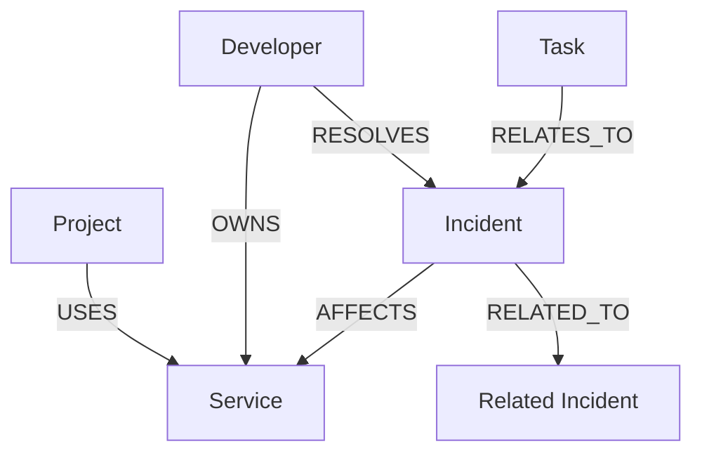
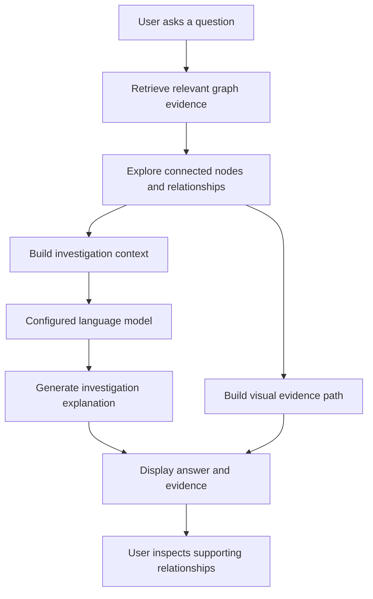
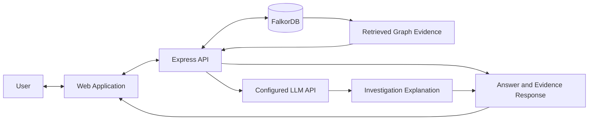

# 🕸️ DevGraph Premium

### Give Your AI Agent a Graph. Make Every Investigation Traceable.

**DevGraph Premium** is a graph-powered AI investigation workspace that connects software services, projects, developers, incidents, and tasks. It helps developers investigate service failures, explore dependencies, discover ownership, and inspect the graph evidence behind AI-generated explanations.

Instead of asking an AI to guess from disconnected information, DevGraph combines structured knowledge-graph evidence with AI-assisted reasoning and a visual evidence path.

\<p align="center">
&#x20; \<a href="[https://devgraph-premium.vercel.app](https://devgraph-premium.vercel.app)">\<strong>🚀 Live Demo\</strong>\</a> ·
&#x20; \<a href="[https://github.com/akshayayuvaraj/devgraph-premium](https://github.com/akshayayuvaraj/devgraph-premium)">\<strong>💻 Source Code\</strong>\</a>
\</p>

---

## 🎯 The Problem

When a service fails, developers need to connect information across multiple sources to answer important questions:

- What depends on the failing service?
- Which developer owns the affected component?
- Which previous incidents may be relevant?
- What evidence supports the investigation?

Disconnected records make these relationships difficult to explore and explain.

## 💡 The Solution

DevGraph Premium represents software-system knowledge as a graph and uses that connected context to support AI-assisted investigations.

The application brings together:

- **Knowledge graph exploration** to inspect connected system entities.
- **AI-assisted investigation** to explain findings from retrieved context.
- **Visual evidence paths** to help users inspect supporting relationships.
- **Incident management** to browse recorded issues and create incidents.

The goal is simple: make software investigations easier to follow and the reasoning behind them easier to inspect.

## 🗺️ The Knowledge Graph

The graph connects five types of entities.

| Node        | What it represents                                  |
| ----------- | --------------------------------------------------- |
| `Service`   | An application service or infrastructure component  |
| `Project`   | A project that uses or depends on a service         |
| `Developer` | A component owner or incident responder             |
| `Incident`  | A recorded issue, including its severity and status |
| `Task`      | An engineering or investigation task                |

### Graph Architecture



*This is a conceptual diagram. The actual node labels, relationship types, and directions should match the graph schema implemented in the repository.*

## 🤖 How the Agent Investigates



### Example Investigation

**Question:** What breaks if `checkout-service` fails, who has worked on it, and what happened before?

The investigation can examine:

1. **Dependencies:** Projects associated with the service.
2. **Ownership:** Developers connected to the component.
3. **Incident history:** Recorded incidents and their status.
4. **Evidence:** Relevant graph connections displayed alongside the explanation.

The configured language model helps explain the retrieved context, while the graph provides a way to inspect the relationships. Results should be validated against the stored data, especially when records are incomplete.

## ✨ Features

- 🔎 **Interactive graph explorer** — search nodes and filter by entity type.
- 🧠 **AI-assisted investigations** — investigate software-system questions using retrieved context.
- 🗺️ **Visual evidence paths** — inspect relationships associated with investigation results.
- 🚨 **Incident workspace** — browse and create incident records.
- 🔗 **Connected system context** — explore relationships among services, projects, developers, incidents, and tasks.
- 🎛️ **Graph controls** — fit the graph to the view and reset its layout.

## 🧰 Technology Stack

| Technology                | Role                       |
| ------------------------- | -------------------------- |
| Node.js                   | JavaScript runtime         |
| Express                   | Backend web framework      |
| FalkorDB                  | Knowledge graph database   |
| OpenRouter-compatible API | Language-model integration |
| Vercel                    | Deployment platform        |

The frontend and configuration details should be confirmed against the actual repository before treating this as a complete dependency list.

## 🏗️ Architecture Overview



This diagram illustrates the intended architecture; verify the deployed request flow against the implementation.

## 🚀 Run Locally

### Prerequisites

- Node.js and npm
- A reachable FalkorDB instance
- Credentials for the configured language-model provider, if required

### Installation

```bash
git clone https://github.com/akshayayuvaraj/devgraph-premium.git
cd devgraph-premium
npm install
```

Configure the environment variables required by the application in a local `.env` file. Never commit credentials or private configuration.

### Start the Server

```bash
npm start
```

Open **[http://localhost:8080](http://localhost:8080)**.

### Run Tests

```bash
npm test
```

Review the test output carefully: integration tests may require external services and may be skipped when those services are unavailable.

## ☁️ Live Demo

**Application:** https://devgraph-premium.onrender.com/

For a reliable demonstration, verify that:

- The application loads in a fresh browser session.
- Authentication works as intended.
- Graph data is retrieved successfully.
- An investigation returns an answer and evidence path.
- Incident browsing and creation work.
- Required database and model-provider integrations are configured in the deployed environment.

A working frontend alone does not guarantee that the backend integrations are functioning.

## 🔐 Security

- Never expose database passwords, API keys, or session secrets.
- Configure secrets through environment variables.
- Protect incident creation and other write operations with authorization.
- Avoid confidential production information in public demonstrations.
- Verify database transport security before using sensitive data.
- Review AI-generated explanations against the available evidence.


## 🌟 Project Vision

DevGraph Premium explores how knowledge graphs can give AI agents connected system context and make investigations easier to inspect.

**Connect the knowledge. Investigate the incident. Inspect the evidence.**
