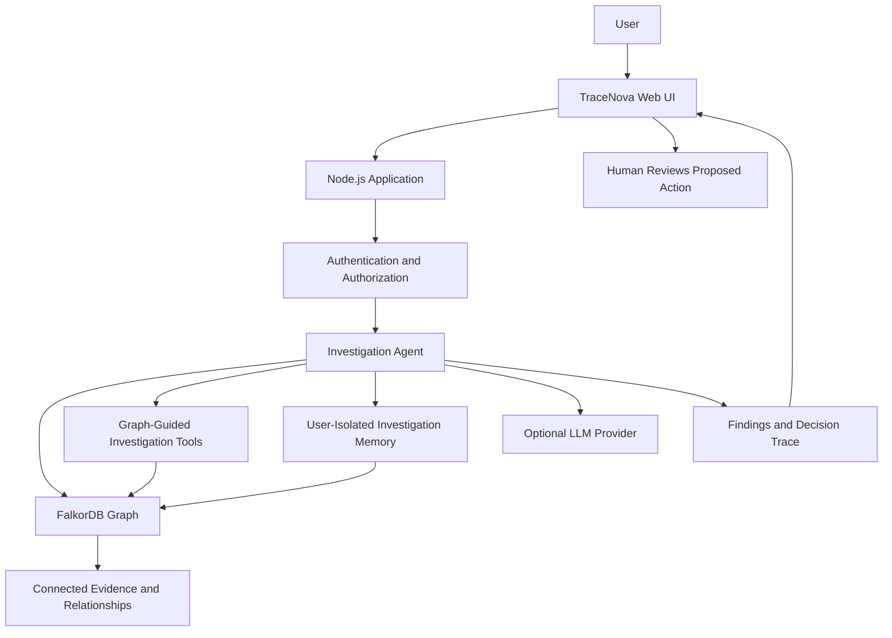

# DevGraph AI Premium — TraceNova

**A traceable, graph-driven incident investigation agent**

[](https://nodejs.org/)
[](https://www.falkordb.com/)
[](https://www.wemakedevs.org/hackathons/falkordb/rules)
[](https://www.wemakedevs.org/hackathons/falkordb/rules)

DevGraph AI Premium, also known as **TraceNova**, is a graph-driven incident-investigation agent built with FalkorDB. It uses connected evidence, relationships, and stored investigation memory to help users understand incidents, trace possible impact, identify uncertainty, and propose actions with an auditable decision trail.

Unlike an agent that relies entirely on an LLM's generated response, TraceNova uses graph evidence to guide investigation decisions. It distinguishes supported findings from conflicting or missing information and keeps proposed actions separate from human authorization.

The application also supports **evidence-only mode**, allowing investigation without an LLM API key.

> **Core principle:** The graph informs the investigation. The agent explains the evidence. A human confirms actions.

---

## Table of Contents

- [Problem Statement](#problem-statement)
- [Solution](#solution)
- [Key Features](#key-features)
- [How It Works](#how-it-works)
- [Architecture](#architecture)
- [Graph Data Model](#graph-data-model)
- [Cypher Queries](#cypher-queries)
- [Technology Stack](#technology-stack)
- [Prerequisites](#prerequisites)
- [Local Setup](#local-setup)
- [Environment Variables](#environment-variables)
- [Testing](#testing)
- [Demo Data](#demo-data)
- [Security and Safety](#security-and-safety)
- [Known Limitations](#known-limitations)
- [Verification Status](#verification-status)
- [Deployment](#deployment)
- [Demo Video](#demo-video)
- [Hackathon Submission](#hackathon-submission)
- [Project Structure](#project-structure)
- [License](#license)

---

## Problem Statement

Incident investigation often requires information from multiple sources: incidents, services, dependencies, events, evidence, tasks, and earlier investigations.

When these relationships are scattered across disconnected records, investigators can struggle to answer important questions:

- What evidence supports the current finding?
- Which connected services or entities might be affected?
- Are there conflicting observations or missing information?
- Did an earlier investigation influence the current conclusion?
- Has the evidence changed since a previous investigation?
- Why was a particular tool or action selected?
- Can a reviewer reproduce and understand the reasoning?

LLM-generated explanations alone do not guarantee that these questions are answered using verifiable evidence.

TraceNova addresses this problem by using a graph as an explicit representation of connected incident context and by retaining traceable investigation results.

## Solution

TraceNova combines graph-driven investigation, optional LLM assistance, evidence citations, and user-isolated memory.

The graph helps determine which investigation tools are relevant, which relationships may matter, and what conclusions the available evidence supports. The system can flag conflicts, missing information, uncertainty, and potentially stale memories.

When an earlier investigation is recalled, its information is checked against the current graph rather than being treated as permanently correct.

Actions remain **proposals**. The agent does not treat a generated recommendation as authorization to perform a consequential action.

When no LLM key is configured, the application can operate in evidence-only mode, making the distinction between graph-supported findings and model-assisted explanation explicit.

## Key Features

### 1. Graph-driven investigation

- Uses FalkorDB to represent connected investigation context.
- Uses graph relationships to guide investigation and tool selection.
- Presents findings with clickable evidence citations.
- Exposes a Decision Trace to help reviewers understand how an investigation proceeded.
- Supports graph search, type filtering, labelled relationships, zoom, pan, fit/reset, node inspection, and highlighted evidence paths.

### 2. Evidence and uncertainty

- Links conclusions to supporting evidence.
- Identifies conflicting or missing information where supported by the investigation data.
- Communicates uncertainty instead of presenting every inference as a confirmed fact.
- Separates available evidence from model-generated explanation.

### 3. Persistent investigation memory

- Stores investigation history for later recall.
- Isolates user-specific memory.
- Re-checks recalled investigation context against the current graph.
- Marks potentially stale memory so previous findings are not blindly trusted.
- Shows memory influence in the investigation interface.

### 4. Human-confirmed actions

- Presents proposed actions separately from findings.
- Requires human confirmation for actions covered by the application's confirmation workflow.
- Records investigation and audit information to support review.

### 5. Incident management

The interface includes an Incidents section with search, filtering, ownership, editing, and task-related workflows.

### 6. Optional LLM integration

- Supports an OpenAI-compatible LLM endpoint.
- Allows model configuration through environment variables.
- Supports evidence-only operation without an LLM API key.
- Includes an LLM connectivity test in Settings.

### 7. Administration and audit

The interface includes Settings and administrative functionality for status, user management, audit information, and configuration, subject to the application's implemented authorization rules.

### 8. Explicit demo-data handling

Demo seeding is a separate, explicit command. It does not run automatically at application startup and is guarded by the configured graph name.

---

## How It Works

A typical investigation follows this workflow:

1. **Receive the question:** The user submits an incident or investigation question.
2. **Consult the graph:** The system uses connected graph context to guide relevant investigation steps.
3. **Gather evidence:** Available investigation tools retrieve information associated with the relevant entities and relationships.
4. **Evaluate findings:** The system distinguishes supporting evidence, conflicts, missing data, and uncertainty.
5. **Generate an explanation:** If an LLM is configured, it may assist with interpretation and explanation. Without one, evidence-only mode remains available.
6. **Build the trace:** The investigation presents supporting evidence and a Decision Trace.
7. **Consult memory:** Relevant prior investigations may inform the current analysis, subject to rechecking against the graph.
8. **Propose an action:** The system presents a possible next step without treating the proposal as authorization.
9. **Human confirmation:** A human reviews and confirms actions through the applicable workflow.
10. **Persist the investigation:** The investigation can be stored and reviewed later, with user isolation and audit functionality as implemented.

The graph is used as structured context, not merely as a visual decoration.

---

## Architecture

The application uses a Node.js server, a browser-based interface, FalkorDB, and an optional LLM provider.



### Main components

| Component | Responsibility |
|---|---|
| Web interface | Investigation, graph exploration, incidents, memory, and settings |
| Node.js server | HTTP routing and application backend |
| Investigation agent | Coordinates graph-guided investigation |
| FalkorDB | Stores connected graph context |
| Evidence layer | Supports traceable findings and citations |
| Memory workflow | Stores and recalls investigation history |
| Optional LLM | Assists with interpretation and explanation |
| Confirmation workflow | Keeps proposed actions separate from human authorization |
| Audit functionality | Supports review of application and investigation activity |

See `docs/architecture.md`, `docs/graph-schema.md`, and `docs/security.md` for implementation-specific details.

---

## Graph Data Model

The graph represents entities and relationships relevant to incident investigation.

The precise labels, properties, relationship types, and constraints must follow the implementation documented in `docs/graph-schema.md`.

The following table describes the **logical model**; it is not a substitute for the actual schema.

| Logical entity | Purpose |
|---|---|
| Incident | Represents an incident being investigated |
| Service or affected entity | Represents a system component or other relevant entity |
| Evidence | Represents an observation or information used to support a finding |
| Investigation | Represents a particular investigation and its result |
| Memory | Represents stored context from an earlier investigation |
| Task or proposed action | Represents a follow-up task or suggested response |
| User | Represents the user context required for access control and memory isolation |

### Relationship concepts

The graph can express relationships such as:

- An incident affects or relates to an entity.
- Evidence supports or conflicts with a finding.
- Entities depend on or connect to other entities.
- An investigation references evidence and related graph context.
- A recalled memory relates to an earlier investigation.
- A proposed action relates to an incident or finding.

Use the exact relationship names from the implemented schema when describing the graph in a submission.

### Why a graph?

A graph makes relationships explicit. Instead of treating each incident as an isolated record, an investigator can traverse connected entities and evidence to discover relevant context.

It also provides a structured basis for explaining why a relationship or evidence item influenced an investigation. Graph connectivity alone does not prove causation; findings must remain grounded in the available evidence.

---

## Cypher Queries

FalkorDB supports Cypher-style graph queries. The following are **illustrative examples**, not claims that these exact statements are used by the current application. Check the schema in `docs/graph-schema.md` and the source code before presenting them as implemented production queries.

### 1. Find an incident by ID

```cypher
MATCH (i:Incident {id: $incidentId})
RETURN i;
```

Purpose: retrieve the incident identified by a parameter.

### 2. Explore directly connected entities

```cypher
MATCH (i:Incident {id: $incidentId})-[r]-(n)
RETURN i, r, n
LIMIT 100;
```

Purpose: inspect direct relationships around an incident.

### 3. Find evidence associated with an incident

```cypher
MATCH (i:Incident {id: $incidentId})-[r]-(e:Evidence)
RETURN i, r, e
LIMIT 100;
```

Purpose: inspect evidence connected to an incident, assuming the implemented schema uses these labels and relationship patterns.

### 4. Inspect a bounded relationship path

```cypher
MATCH p = (i:Incident {id: $incidentId})-[*1..3]-(n)
RETURN p
LIMIT 100;
```

Purpose: explore connected context within a bounded path length. This example is exploratory and should be adapted to the actual schema and query-performance requirements.

### 5. Retrieve the current graph context for a recalled memory

Conceptually, memory recall should retrieve the relevant entities and relationships again rather than assume that a stored conclusion remains current. The exact query depends on the memory schema and its relationship to incidents, evidence, and users.

**Submission requirement:** Document the actual Cypher queries or graph algorithms on which the product depends. Before submitting, replace or supplement these examples with the real queries from the repository. Do not claim that illustrative queries are executed by the application unless you verify that they are.

---

## Technology Stack

| Technology | Role |
|---|---|
| Node.js 22.9+ | Runtime required by the supplied project instructions |
| JavaScript | Application implementation |
| FalkorDB | Graph database |
| Cypher-style queries | Graph retrieval and relationship traversal |
| HTML, CSS, and JavaScript | Browser interface |
| OpenAI-compatible API | Optional LLM integration |
| npm | Dependency management and scripts |
| Git and GitHub | Source control and public repository |

The application can run without an LLM key in evidence-only mode, but it still requires a reachable FalkorDB instance for database-backed functionality.

---

## Prerequisites

Before starting, install or configure:

- Node.js 22.9 or newer.
- npm, included with Node.js.
- Git, if cloning from GitHub.
- A reachable FalkorDB instance.
- FalkorDB connection credentials.
- An optional API key for a compatible LLM provider.

For a hosted deployment, the application server must be able to reach the database over the network. A database address of `localhost` on your personal computer will not work from a remote deployment.

---

## Local Setup

The following instructions use a new installation folder. They do not overwrite the original project at `D:\devgraph`.

### 1. Extract the project

If you have `devgraph-premium.zip` in the current directory:

```powershell
node --version

Expand-Archive .\devgraph-premium.zip -DestinationPath D:\

cd D:\devgraph-premium
```

If you are using the public GitHub repository instead:

```powershell
git clone https://github.com/akshayayuvaraj/devgraph-premium.git D:\devgraph-premium

cd D:\devgraph-premium
```

Do not extract the archive over the original project directory.

### 2. Install dependencies

```powershell
npm install
```

### 3. Create the environment file

```powershell
Copy-Item .env.example .env
```

Edit `.env` with a text editor and configure your FalkorDB connection.

**Never commit `.env` or share its credentials publicly.** Keep API keys and database passwords in environment variables, not browser-side JavaScript or screenshots.

### 4. Initialize the graph schema

```powershell
npm run init
```

According to the supplied project instructions, this command initializes indexes and creates no data.

### 5. Optionally seed demo data

```powershell
npm run seed:demo
```

Demo data is optional. The supplied instructions state that seeding is explicitly invoked and guarded by `FALKOR_GRAPH=devgraph-premium`.

Run it only when you intentionally want the labelled demo dataset. Do not run it against a graph containing data you need to preserve.

### 6. Start the application

```powershell
npm start
```

Open:

- Landing page: `http://localhost:8080`
- Application: `http://localhost:8080/app.html`

The first account becomes the administrator according to the supplied setup instructions. Use a secure password and configure signup behavior appropriately for the environment.

---

## Environment Variables

Configure these variables in `.env` for local development or in your hosting provider's secret/environment-variable settings for deployment.

| Variable | Purpose |
|---|---|
| `FALKOR_HOST` | FalkorDB hostname |
| `FALKOR_PORT` | FalkorDB port |
| `FALKOR_USERNAME` | Database username |
| `FALKOR_PASSWORD` | Database password |
| `FALKOR_TLS` | Set to `true` when TLS is required |
| `FALKOR_URL` | Alternative single connection URL |
| `FALKOR_GRAPH` | Graph name; the supplied project defaults to `devgraph-premium` |
| `LLM_API_KEY` | Optional LLM API key |
| `LLM_BASE_URL` | Optional OpenAI-compatible API base URL |
| `LLM_MODEL` | Optional model identifier |
| `PORT` | HTTP server port |
| `ALLOW_SIGNUP` | Signup behavior |
| `TRUST_PROXY` | Proxy-trust configuration |
| `NODE_ENV` | Runtime environment |

### Graph safety

The supplied project instructions identify `devgraph-premium` as the intended graph name and state that `devgraph` and `devgraph-test` are refused.

Confirm the actual defaults and restrictions in the implementation before changing graph names.

### Example configuration

```dotenv
FALKOR_HOST=your-falkordb-host
FALKOR_PORT=your-falkordb-port
FALKOR_USERNAME=default
FALKOR_PASSWORD=your-secret-password
FALKOR_TLS=true
FALKOR_GRAPH=devgraph-premium

LLM_API_KEY=
LLM_BASE_URL=
LLM_MODEL=

PORT=8080
NODE_ENV=development
```

This is a template, not a working connection configuration. Replace the placeholder database values with the details from your FalkorDB provider.

If you use `FALKOR_URL`, follow the project's documented URL format and percent-encode reserved characters in credentials. Avoid configuring conflicting connection methods.

---

## Testing

Run the project test suite:

```powershell
npm test
```

The supplied project documentation states that tests use temporary graph names such as `devgraph_test_<random>` and drop only those temporary graphs.

When FalkorDB is unavailable, database-dependent live tests may skip with a printed reason.

### Testing with a reachable FalkorDB instance

The following PowerShell example configures credentials only for the current terminal session:

```powershell
$env:FALKOR_HOST = 'your-host'
$env:FALKOR_PORT = 'your-port'
$env:FALKOR_USERNAME = 'default'

$env:FALKOR_PASSWORD = Read-Host 'FalkorDB password'
$env:FALKOR_TLS = 'true'

npm test

Remove-Item Env:FALKOR_PASSWORD
```

Use the actual host, port, username, and TLS requirements provided by your database service.

Do not run live tests against a database you cannot afford to interrupt. Confirm the temporary-graph behavior in the current test code before using a shared or sensitive database.

---

## Demo Data

TraceNova does not automatically invent or populate a dataset on startup.

To load the explicitly labelled demo scenario:

```powershell
npm run seed:demo
```

Use the command only when the configured graph name satisfies the application's seed guard.

For a demonstration, explain which records are demo data and which conclusions are supported by the graph. Do not present seeded examples as real incidents or claim real-world operational impact from synthetic records.

---

## Security and Safety

TraceNova is designed around traceability and human review, but it should not be described as independently security-certified or production-ready.

### Security principles

- Keep API keys and database credentials server-side.
- Use user-isolated investigation memory.
- Apply authorization checks to protected operations.
- Treat evidence and model-generated explanations as distinct.
- Recheck recalled information against the current graph.
- Separate proposed actions from human confirmation.
- Use explicit demo seeding rather than automatic data creation.
- Review audit information when investigating application behavior.

### Deployment checklist

Before exposing the application publicly:

- Use strong database credentials and TLS where required.
- Store secrets in the hosting provider's environment-variable settings.
- Ensure the deployed server can reach FalkorDB securely.
- Configure signup and administrator access deliberately.
- Verify session, cookie, and proxy settings.
- Test user isolation and authorization with separate accounts.
- Avoid exposing database credentials or internal error details in API responses.
- Review `docs/security.md`.
- Perform an independent security review before using the system for sensitive incidents.

**Important:** Human confirmation in the interface does not replace a security review of the backend authorization and action-execution paths.

---

## Known Limitations

The following limitations were identified in the supplied project description:

- No independent security review has been completed.
- Multi-factor authentication (MFA) is not covered.
- Multi-agent coordination is not included.
- MCP integration is not included.
- Graph-algorithm tools such as PageRank are not included.
- Light-theme logo auto-switching is not included.
- Real-browser rendering, visual layout, and animations were not verified in the described sandbox testing.
- A real LLM provider was not verified; a mock server was used for the described provider tests.
- The supplied sandbox verification does not establish that the user's Windows environment or FalkorDB Cloud instance has been tested.

Additional limitations may be documented in `docs/security.md`.

---

## Verification Status

The following status is based on the project report supplied with this repository description. It is not an independent test performed by this README's author.

### Reported as verified in the development sandbox

- 64/64 tests passed twice in a row against an embedded `falkordblite` / Redis 8.6 test environment.
- The reported test coverage includes the demo investigation flow, graph-driven actions with provenance, stale-memory detection, memory isolation, guarded seeding, and UI behavior tested with jsdom.
- Without a reachable database, the report states that 27 tests passed and 37 were skipped, with zero failures.
- Earlier testing reportedly checked password authentication and TLS certificate verification against the test engine.

### Not verified in the supplied report

- The Windows installation on the intended user's machine.
- The actual FalkorDB Cloud instance.
- The official Docker image.
- Real-browser rendering, layout, and animation behavior.
- A real LLM provider.

These statements are reported development results, not a guarantee that every environment or deployment will behave identically. Rerun the current repository's tests and record the actual output before submitting.

---

## Deployment

The application requires a persistent, reachable FalkorDB service for database-backed functionality.

A public deployment must configure the database and optional LLM credentials securely. Do not deploy with a database hostname that resolves only on your local machine.

### Vercel considerations

Vercel can host compatible Node.js serverless functions, but a conventional long-running Express server may require adaptation to Vercel's routing and function model.

Before deploying this project to Vercel:

1. Inspect `src/server.js` and determine how the HTTP server is started.
2. Confirm that the application exports or exposes a Vercel-compatible request handler.
3. Confirm that the listening port and static-file routing are compatible with the selected deployment configuration.
4. Configure all required FalkorDB and optional LLM environment variables in Vercel.
5. Ensure that FalkorDB is remotely reachable from the deployed function.
6. Test authentication, graph queries, investigations, memory, and proposed-action confirmation on the deployed URL.

A successful build or homepage load alone does not prove that graph-backed features work.

**Deployment status:** A working public deployment URL has not been supplied in this README. Add it only after deployment and end-to-end verification.

---

## Demo Video

**Demo video:** Add your public video URL here after uploading the recording.

Recommended demonstration sequence:

1. Introduce the incident-investigation problem and TraceNova's graph-driven approach.
2. Show the application landing page and Overview.
3. Open an investigation and submit a question using the labelled demo scenario.
4. Show the answer, clickable evidence citations, Decision Trace, and uncertainty indicators.
5. Open the graph view and inspect connected entities and evidence paths.
6. Demonstrate memory recall and stale-memory handling.
7. Show a proposed action and the human-confirmation workflow.
8. Demonstrate evidence-only mode without an LLM key, if verified in the current build.
9. Briefly explain the graph schema and the Cypher queries used by the actual application.
10. Close with the architecture, limitations, and future work.

Use a dataset clearly labelled as demo data. Avoid exposing credentials, private user data, or real incident details.

---

## Hackathon Submission

**Event:** Graph Hacks 2026  
**Track:** Track 01 — confirm the official track name and requirements against the event rules before submission.  
**Project:** DevGraph AI Premium — TraceNova  
**Repository:** https://github.com/akshayayuvaraj/devgraph-premium  
**Live deployment:** Add the verified public URL, if available.  
**Demo video:** Add the public video URL.  
**Graph data model:** `docs/graph-schema.md`  
**Architecture:** `docs/architecture.md`  
**Security notes:** `docs/security.md`  
**Demo walkthrough:** `docs/demo-script.md`

Before filing the submission, check the official rules:

https://www.wemakedevs.org/hackathons/falkordb/rules

### Submission checklist

- [ ] Public source-code repository is accessible.
- [ ] README includes setup instructions.
- [ ] README documents the actual graph data model.
- [ ] Actual Cypher queries or graph algorithms used by the product are documented.
- [ ] Demo video is uploaded and publicly accessible to judges.
- [ ] A verified live deployment URL is supplied, or complete local setup instructions are available.
- [ ] Track selection matches the official event options.
- [ ] Test results reflect the current source revision.
- [ ] No credentials, tokens, or private environment files are committed.
- [ ] All claims about AI, security, graph reasoning, and verification are supported by the implementation.

---

## Project Structure

The supplied project description identifies these main paths:

```text
devgraph-premium/
├── public/
│   ├── brand/
│   └── app.html
├── src/
│   ├── agent.js
│   └── server.js
├── docs/
│   ├── architecture.md
│   ├── graph-schema.md
│   ├── demo-script.md
│   └── security.md
├── .env.example
├── .gitignore
├── package.json
└── README.md
```

This is a high-level illustration of the supplied project structure. Verify the actual directory contents before treating it as an exhaustive file listing.

---

## License

Add the repository's chosen license and its corresponding `LICENSE` file before claiming that the project is released under a particular open-source license.

---

## Final Note

TraceNova explores a practical approach to graph-driven AI agents: using connected evidence to guide investigation, preserving the trace behind a conclusion, rechecking remembered context, and keeping consequential actions subject to human confirmation.

Its goal is not to make an agent sound certain. Its goal is to make the investigation easier to inspect, challenge, and review.

**TraceNova — Investigate with context. Explain with evidence. Act with human confirmation.**
